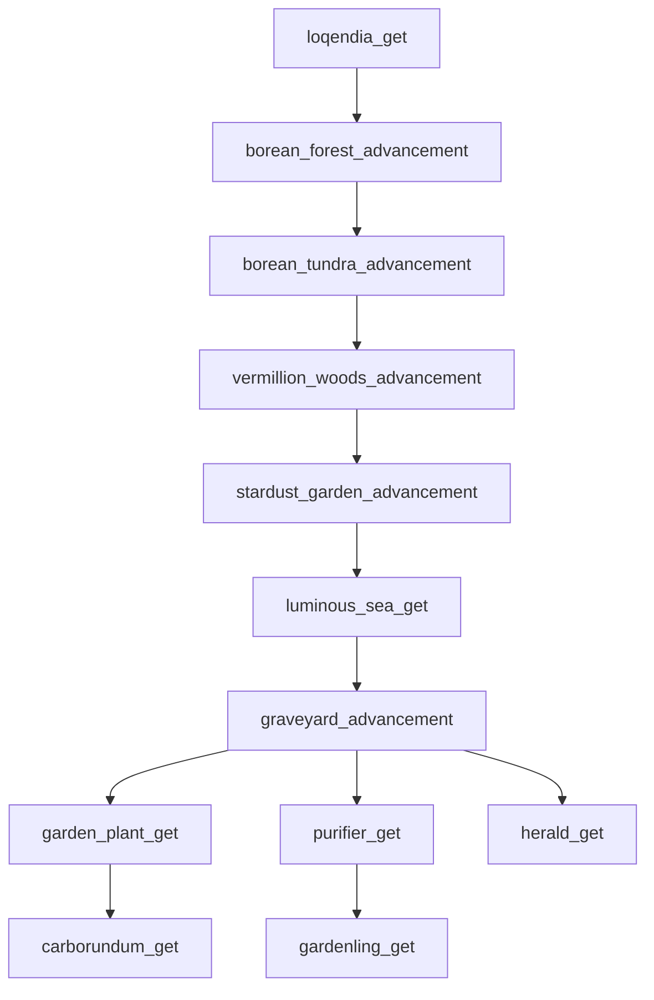

# 原 Advancement 全族迁移审计

只读全部原 JAR `data/thermal_shock/advancements/*.json` 及 Java 授予/读取引用，目标1.21.1源码核格式；不改main/resources、不构建或运行游戏。原69项全部纳入，另有奖励loot `loot_tables/advancements/beta_complete.json`，它不是第70个advancement。结构化证据：`D:/AI临时文件/ThermalShockMigration/advancement-original-graph.json`，含全部原JSON、criteria/requirements、奖励loot全文、直接授予与检查引用的准确行、procedure全文和反向caller文件/调用行；原JAR SHA256也记录其中。

## 结论与边界

原69项：34 impossible、21 inventory_changed、8 location、3 consume_item、1 placed_block、2 changed_dimension、1 entity_hurt_player。父图无缺失的本模组parent；keystone_get外接原版minecraft:story/form_obsidian。数据父闭合不等于物品/群系/维度/实体/奖励与授予caller闭合。

当前不能完整导入任何原根链：errands_get与loqendia_get图标均依赖未迁keystone，前者还依赖Qo/Concierge真实任务对话授予；loqendia_get条件还需真实维度loqendia。无display根palace_get需要真实aqeron。原版父下的keystone_get同样需要真实keystone。不能用普通占位keystone、删除icon、改parent、跳过NPC条件来制造闭合。

已有实际功能可优先接入的叶节点：spice_get/siibol_get、raw/cooked_torpedo与icy_snowcone食用、herald_get；材料inventory条件bismuth/bloodstone/malachite/ruby/cobalt等具真实注册，但lapidary_get父及授予装置仍未闭合。现有BreatherSpongeBlock授予breather_sponge_get，ArmorSetEvents授予carborundum_get/zenith_get，FarmSeedBlock授予garden_plant_get；它们查询进度不存在时安全跳过。不能由“caller已迁”宣称整条进度可用。

cauldron_get与sanctum_get为impossible，readable全部Java及原JAR全部class的精确ID常量引用均零；它们原本不可自然完成。保留记录，未来若补触发须明确授权修复，不能因Cauldron已迁便擅改为放置/获取条件。其他impossible逐项真实caller见下表与JSON，读进度门槛的引用不能当授予入口；procedure有反向caller才说明被调用，事件注解也单独记录，不按名称猜触发。

## 农业真实父链

其中8个location进度必须使用真实各群系（还包括cobalt_heights、glaciation）；当前无对应biome JSON，不可只导parent声明完整。garden_plant_get实际由SkorioSeedOnBlockRightClickedProcedure在种子生长/施肥流程授予，反向12种种子caller全列JSON；不是种下种子就无条件发。原奖励10XP，carborundum_get10XP，purifier_get200XP，gardenling_get49XP。root已核原构造器onPlace即时删块，BlockItem.place后检查已不是placedblock，PLACED_BLOCK.trigger被跳过。将来需在合法玩家放置且实际单次消费构造成功的上下文显式完成gardenling_get（保49XP/原条件意图），不能现在改Gardenling或每次实体spawn就发。单纯在已变AIR处调用PLACED_BLOCK.trigger仍读取AIR，不能匹配原block_state_property，需设计真实放置证据入口，避免命令/召唤刷奖励。

## 1.21.1格式与API差异

- 数据目录改`data/<namespace>/advancement/`单数，奖励loot改`loot_table/`，保奖励ID中的`advancements/beta_complete`路径不因目录单数擅改ID。ServerAdvancementManager通过Registries.elementsDirPath(ADVANCEMENT)读取并用Advancement条件Codec解析。
- DisplayInfo.CODEC.icon使用ItemStack.STRICT_CODEC；旧`icon.item`改`icon.id`，需要真实非AIR物品。标题/描述翻译、background、frame、hidden、toast/chat全部保留，palace_get原无display不强加显示。
- LocationPredicate.CODEC字段为`biomes`（HolderSet），原8项`location.biome`必须改为`location.biomes`数组或合法单ID HolderSet形式。旧字段可能被忽略而把到指定群系误变为任意位置完成，不能仅以JSON能解析判通过。
- ItemPredicate.items继续为注册HolderSet，不能把criteria中的`items`也机械改成`id`；原count上下限、伤害taken0..90/blocked=false、维度to等要逐项保留。squall_get明确依赖真实实体thermal_shock:squall，不能以缺失注册的ID谓词导入。
- placed_block仍是CriteriaTriggers.PLACED_BLOCK，目标实现为ItemUsedOnLocationTrigger：location是ContextAwarePredicate列表，原block_state_property形式可保，但其触发读取当前位置BLOCK_STATE。PlayerAdvancements.award接受AdvancementHolder，ServerAdvancementManager.get(ResourceLocation)，不是旧getAdvancement；原模组现有ArmorSetEvents已体现新API。
- Advancement.CODEC未给requirements时按所有criteria AND推导；lod_pozar_get两条inventory criterion因此必须均完成，并非任意一奖杯。不可迁成OR，也不能把AND改为同一背包同时拥有（原是分别进度可保留）。原奖励3000XP+diskette_4。
- parent是图形/树依赖，不是自动授予条件。目标PlayerAdvancements.award只处理当前criteria与完成奖励，不自动检查/发放parent；实际监听也不能额外加“父进度已完成”门槛改变原规则。未加载parent会影响树连接/展示，所以迁移仍按完整链管理。

## 原奖励完整保留

四表均原type=advancement_reward、每pool rolls1、每item count1：frigid_altar_get为10XP+diskette_6；lod_pozar_get为3000XP+diskette_4；beta_complete为1000XP+crystal_sopel_trophy与phobos_lament；thermofebruary_get为100XP+golden_pillar与arctic_warmth_legacy。后两组四个物品尚未真实注册；前两盘已真实注册但altar/LOD caller链仍未闭合。random_sequence是随机序列标识，不当作物品/外部loot依赖。

## 全69项矩阵

表中条件为原criteria全文，奖励为空表示原无奖励；caller只列授予引用，读取/门槛与反向caller在结构化JSON保留。所有ID默认thermal_shock命名空间。表内“无”不是TODO占位，表示原未找到授予caller；普通原生trigger由游戏触发。

|ID|Parent|原criteria|原奖励|原授予procedure|
|---|---|---|---|---|
|babies_or_pets|thermal_shock:errands_get|`{"babies_or_pets_0":{"trigger":"minecraft:impossible"}}`|`{}`|LautErrandAcceptProcedure|
|beta_complete|thermal_shock:sanctum_get|`{"beta_complete_0":{"trigger":"minecraft:impossible"}}`|`{"experience":1000,"loot":["thermal_shock:advancements/beta_complete"]}`|SopelIntroProgressProcedure SopelKeystoneRejectProcedure|
|bismuth_get|thermal_shock:lapidary_get|`{"bismuth_get_0":{"trigger":"minecraft:inventory_changed","conditions":{"items":[{"items":["thermal_shock:bismuth"],"count":{"min":1,"max":64}}]}}}`|`{"experience":10}`|原生trigger|
|blackpowder_get|thermal_shock:spice_get|`{"blackpowder_get_0":{"trigger":"minecraft:inventory_changed","conditions":{"items":[{"items":["thermal_shock:blackpowder_spice"],"count":{"min":1,"max":64}}]}}}`|`{}`|原生trigger|
|blasphemy_1|thermal_shock:errands_get|`{"blasphemy_1_0":{"trigger":"minecraft:impossible"}}`|`{}`|ConcErrandsEpl3OpenProcedure|
|blasphemy_2|thermal_shock:blasphemy_1|`{"blasphemy_2_0":{"trigger":"minecraft:impossible"}}`|`{}`|GrandBlasphemerOnBlockRightClickedProcedure|
|blasphemy_3|thermal_shock:blasphemy_2|`{"blasphemy_3_0":{"trigger":"minecraft:impossible"}}`|`{}`|ExtractorOnBlockRightClickedProcedure|
|blasphemy_4|thermal_shock:blasphemy_3|`{"blasphemy_4_0":{"trigger":"minecraft:impossible"}}`|`{"experience":500}`|ConcMainPageOpenProcedure|
|bloodstone_get|thermal_shock:lapidary_get|`{"bloodstone_get_0":{"trigger":"minecraft:inventory_changed","conditions":{"items":[{"items":["thermal_shock:bloodstone"],"count":{"min":1,"max":64}}]}}}`|`{"experience":10}`|原生trigger|
|borean_forest_advancement|thermal_shock:loqendia_get|`{"borean_forest_advancement_0":{"trigger":"minecraft:location","conditions":{"player":[{"condition":"minecraft:entity_properties","entity":"this","predicate":{"location":{"biome":"thermal_shock:borean_forest"}}}]}}}`|`{}`|原生trigger|
|borean_tundra_advancement|thermal_shock:borean_forest_advancement|`{"borean_tundra_advancement_0":{"trigger":"minecraft:location","conditions":{"player":[{"condition":"minecraft:entity_properties","entity":"this","predicate":{"location":{"biome":"thermal_shock:borean_tundra"}}}]}}}`|`{}`|原生trigger|
|breather_sponge_get|thermal_shock:luminous_sea_get|`{"breather_sponge_get_0":{"trigger":"minecraft:impossible"}}`|`{}`|BreatherSpongeOnBlockRightClickedProcedure|
|carborundum_get|thermal_shock:garden_plant_get|`{"carborundum_get_0":{"trigger":"minecraft:impossible"}}`|`{"experience":10}`|CarborundumArmorEffectProcedure|
|cauldron_get|thermal_shock:spice_get|`{"cauldron_get_0":{"trigger":"minecraft:impossible"}}`|`{}`|无|
|cavebloomer_kill|thermal_shock:glaciation_get|`{"cavebloomer_kill_0":{"trigger":"minecraft:impossible"}}`|`{"experience":1000}`|AngryCavebloomerEntityDiesProcedure|
|climbing_pick_get|thermal_shock:fabricator_get|`{"climbing_pick_get_0":{"trigger":"minecraft:inventory_changed","conditions":{"items":[{"items":["thermal_shock:climbing_pick"],"count":{"min":1,"max":1}}]}}}`|`{"experience":10}`|原生trigger|
|cobalt_get|thermal_shock:loqendia_get|`{"cobalt_get_0":{"trigger":"minecraft:inventory_changed","conditions":{"items":[{"items":["thermal_shock:cobalt"],"count":{"min":1,"max":64}}]}}}`|`{}`|原生trigger|
|cobalt_heights_get|thermal_shock:loqendia_get|`{"cobalt_heights_get_0":{"trigger":"minecraft:location","conditions":{"player":[{"condition":"minecraft:entity_properties","entity":"this","predicate":{"location":{"biome":"thermal_shock:cobalt_heights"}}}]}}}`|`{}`|原生trigger|
|cooked_torpedo_consume_get|thermal_shock:torpedo_consume_get|`{"cooked_torpedo_consume_get_0":{"trigger":"minecraft:consume_item","conditions":{"item":{"items":["thermal_shock:cooked_torpedo"]}}}}`|`{}`|原生trigger|
|corroded_get|thermal_shock:ferrous_get|`{"corroded_get_0":{"trigger":"minecraft:inventory_changed","conditions":{"items":[{"items":["thermal_shock:corroded_rock"],"count":{"min":1,"max":64}}]}}}`|`{}`|原生trigger|
|drinking_straw_get|thermal_shock:breather_sponge_get|`{"drinking_straw_get_0":{"trigger":"minecraft:inventory_changed","conditions":{"items":[{"items":["thermal_shock:silly_straw"],"count":{"min":1,"max":64}}]}}}`|`{}`|原生trigger|
|errands_get|根|`{"errands_get_0":{"trigger":"minecraft:impossible"}}`|`{}`|ConcErrandsPageOpenProcedure QoAlloyErrandAcceptProcedure QoPageingProcedure|
|errant_get|thermal_shock:borean_tundra_advancement|`{"errant_get_0":{"trigger":"minecraft:impossible"}}`|`{"experience":100}`|ErrantEntityDiesProcedure|
|fabricator_get|thermal_shock:frigid_altar_get|`{"fabricator_get_0":{"trigger":"minecraft:inventory_changed","conditions":{"items":[{"items":["thermal_shock:fabricator_constructor"],"count":{"min":1,"max":64}}]}}}`|`{}`|原生trigger|
|ferrous_altar_get|thermal_shock:ferrous_get|`{"ferrous_altar_get_0":{"trigger":"minecraft:inventory_changed","conditions":{"items":[{"items":["thermal_shock:ferrous_altar"],"count":{"min":1,"max":64}}]}}}`|`{"experience":5}`|原生trigger|
|ferrous_get|thermal_shock:loqendia_get|`{"ferrous_get_0":{"trigger":"minecraft:inventory_changed","conditions":{"items":[{"items":["thermal_shock:ferrous_rock"],"count":{"min":1,"max":64}}]}}}`|`{}`|原生trigger|
|frigid_altar_get|thermal_shock:lapidary_get|`{"frigid_altar_get_0":{"trigger":"minecraft:impossible"}}`|`{"experience":10,"loot":["thermal_shock:altar_get_reward"]}`|FrigidAltarOnBlockRightClickedProcedure|
|frost_titan_core_kill_get|thermal_shock:cobalt_get|`{"frost_titan_core_kill_get_0":{"trigger":"minecraft:impossible"}}`|`{"experience":10000}`|FlareCoreEntityIsHurtProcedure|
|garden_plant_get|thermal_shock:graveyard_advancement|`{"garden_plant_get_0":{"trigger":"minecraft:impossible"}}`|`{"experience":10}`|SkorioSeedOnBlockRightClickedProcedure|
|gardenling_get|thermal_shock:purifier_get|`{"gardenling_get_0":{"trigger":"minecraft:placed_block","conditions":{"location":[{"condition":"minecraft:block_state_property","block":"thermal_shock:gardenling_constructor"}]}}}`|`{"experience":49}`|原生trigger|
|glaciation_get|thermal_shock:loqendia_get|`{"glaciation_get_0":{"trigger":"minecraft:location","conditions":{"player":[{"condition":"minecraft:entity_properties","entity":"this","predicate":{"location":{"biome":"thermal_shock:glaciation"}}}]}}}`|`{}`|原生trigger|
|glastrekker_armor_get|thermal_shock:corroded_get|`{"glastrekker_armor_get_0":{"trigger":"minecraft:impossible"}}`|`{}`|GlastrekkerRightClickOnProcedure|
|graveyard_advancement|thermal_shock:luminous_sea_get|`{"graveyard_advancement_0":{"trigger":"minecraft:location","conditions":{"player":[{"condition":"minecraft:entity_properties","entity":"this","predicate":{"location":{"biome":"thermal_shock:graveyard"}}}]}}}`|`{}`|原生trigger|
|herald_get|thermal_shock:graveyard_advancement|`{"herald_get_0":{"trigger":"minecraft:inventory_changed","conditions":{"items":[{"items":["thermal_shock:herald_key"],"count":{"min":1,"max":1}}]}}}`|`{"experience":30}`|原生trigger|
|hpsm_get|thermal_shock:ferrous_get|`{"hpsm_get_0":{"trigger":"minecraft:impossible"}}`|`{"experience":10}`|HPSMRightclickedOnBlockProcedure|
|icebreaker_1|thermal_shock:errands_get|`{"icebreaker_1_0":{"trigger":"minecraft:impossible"}}`|`{}`|QoPageingProcedure|
|icebreaker_2|thermal_shock:icebreaker_1|`{"icebreaker_2_0":{"trigger":"minecraft:impossible"}}`|`{}`|BackdoorScarabAssemblerProcedure|
|icidrozerk_mace_kill_get|thermal_shock:fabricator_get|`{"icidrozerk_mace_kill_get_0":{"trigger":"minecraft:impossible"}}`|`{}`|ZerkerGauntletLivingEntityIsHitWithItemProcedure|
|keystone_get|minecraft:story/form_obsidian|`{"keystone_get_0":{"trigger":"minecraft:inventory_changed","conditions":{"items":[{"items":["thermal_shock:keystone"],"count":{"min":1,"max":1}}]}}}`|`{"experience":100}`|原生trigger|
|knight_edge_get|thermal_shock:lod_pozar_get|`{"knight_edge_get_0":{"trigger":"minecraft:inventory_changed","conditions":{"items":[{"items":["thermal_shock:knights_edge"],"count":{"min":1,"max":1}}]}}}`|`{"experience":500}`|原生trigger|
|lapidary_get|thermal_shock:cobalt_get|`{"lapidary_get_0":{"trigger":"minecraft:impossible"}}`|`{"experience":10}`|LapidarianWorkbenchNeighbourBlockChangesProcedure|
|leaf_it_to_me_1|thermal_shock:errands_get|`{"leaf_it_to_me_1_0":{"trigger":"minecraft:impossible"}}`|`{}`|UnePageingProcedure|
|leaf_it_to_me_2|thermal_shock:leaf_it_to_me_1|`{"leaf_it_to_me_2_0":{"trigger":"minecraft:impossible"}}`|`{}`|WideAngleRightclickedProcedure|
|leaf_it_to_me_3|thermal_shock:leaf_it_to_me_2|`{"leaf_it_to_me_3_0":{"trigger":"minecraft:impossible"}}`|`{"experience":300}`|UneErrandsOpenProcedure|
|lod_pozar_get|thermal_shock:fabricator_get|`{"lod_pozar_get_0":{"trigger":"minecraft:inventory_changed","conditions":{"items":[{"items":["thermal_shock:icidrogunner_trophy"],"count":{"min":1,"max":1}}]}},"lod_pozar_get_1":{"trigger":"minecraft:inventory_changed","conditions":{"items":[{"items":["thermal_shock:icidroburner_trophy"],"count":{"min":1,"max":1}}]}}}`|`{"experience":3000,"loot":["thermal_shock:lod_pozar_first_kill"]}`|原生trigger|
|loqendia_get|根|`{"loqendia_get_0":{"trigger":"minecraft:changed_dimension","conditions":{"to":"thermal_shock:loqendia"}}}`|`{"experience":10}`|原生trigger|
|luminous_sea_get|thermal_shock:stardust_garden_advancement|`{"luminous_sea_get_0":{"trigger":"minecraft:location","conditions":{"player":[{"condition":"minecraft:entity_properties","entity":"this","predicate":{"location":{"biome":"thermal_shock:luminous_sea"}}}]}}}`|`{}`|原生trigger|
|malachite_get|thermal_shock:lapidary_get|`{"malachite_get_0":{"trigger":"minecraft:inventory_changed","conditions":{"items":[{"items":["thermal_shock:malachite"],"count":{"min":1,"max":64}}]}}}`|`{"experience":10}`|原生trigger|
|palace_get|根|`{"palace_get_0":{"trigger":"minecraft:changed_dimension","conditions":{"to":"thermal_shock:aqeron"}}}`|`{"experience":10}`|原生trigger|
|purifier_get|thermal_shock:graveyard_advancement|`{"purifier_get_0":{"trigger":"minecraft:impossible"}}`|`{"experience":200}`|PurifierBlockIsPlacedByProcedure|
|rain_drum_get|thermal_shock:luminous_sea_get|`{"rain_drum_get_0":{"trigger":"minecraft:impossible"}}`|`{"experience":10}`|RainDrumBlockIsPlacedByProcedure|
|ruby_get|thermal_shock:lapidary_get|`{"ruby_get_0":{"trigger":"minecraft:inventory_changed","conditions":{"items":[{"items":["thermal_shock:ruby"],"count":{"min":1,"max":64}}]}}}`|`{"experience":10}`|原生trigger|
|sanctum_get|thermal_shock:fabricator_get|`{"sanctum_get_0":{"trigger":"minecraft:impossible"}}`|`{"experience":100}`|无|
|siibol_get|thermal_shock:stardust_garden_advancement|`{"siibol_get_0":{"trigger":"minecraft:inventory_changed","conditions":{"items":[{"items":["thermal_shock:bucket_of_siibol"],"count":{"min":1,"max":64}}]}}}`|`{}`|原生trigger|
|snowcone_consume_get|thermal_shock:luminous_sea_get|`{"snowcone_consume_get_0":{"trigger":"minecraft:consume_item","conditions":{"item":{"items":["thermal_shock:icy_snowcone"]}}}}`|`{}`|原生trigger|
|spear_kill_get|thermal_shock:ruby_get|`{"spear_kill_get_0":{"trigger":"minecraft:impossible"}}`|`{}`|RubySpearLivingEntityIsHitWithItemProcedure|
|spice_get|thermal_shock:loqendia_get|`{"spice_get_0":{"trigger":"minecraft:inventory_changed","conditions":{"items":[{"items":["thermal_shock:adamantine_spice"],"count":{"min":1,"max":64}}]}}}`|`{}`|原生trigger|
|squall_get|thermal_shock:borean_tundra_advancement|`{"squall_get_0":{"trigger":"minecraft:entity_hurt_player","conditions":{"damage":{"taken":{"min":0,"max":90},"source_entity":{"type":"thermal_shock:squall"},"blocked":false}}}}`|`{"experience":10}`|原生trigger|
|squall_kill_get|thermal_shock:squall_get|`{"squall_kill_get_0":{"trigger":"minecraft:impossible"}}`|`{"experience":10000}`|SquallEntityDiesProcedure|
|stardust_garden_advancement|thermal_shock:vermillion_woods_advancement|`{"stardust_garden_advancement_0":{"trigger":"minecraft:location","conditions":{"player":[{"condition":"minecraft:entity_properties","entity":"this","predicate":{"location":{"biome":"thermal_shock:stardust_garden"}}}]}}}`|`{}`|原生trigger|
|stratus_reactor_get|thermal_shock:squall_get|`{"stratus_reactor_get_0":{"trigger":"minecraft:impossible"}}`|`{"experience":10}`|StratusReactorCoreOnBlockRightClickedProcedure|
|thermofebruary_get|thermal_shock:yoylecake|`{"thermofebruary_get_0":{"trigger":"minecraft:impossible"}}`|`{"experience":100,"loot":["thermal_shock:thermofebruary"]}`|BrimCakeRightClickProcedure|
|torpedo_consume_get|thermal_shock:luminous_sea_get|`{"torpedo_consume_get_0":{"trigger":"minecraft:consume_item","conditions":{"item":{"items":["thermal_shock:raw_torpedo"]}}}}`|`{"experience":50}`|原生trigger|
|uneasy_alliance_1|thermal_shock:errands_get|`{"uneasy_alliance_1_0":{"trigger":"minecraft:impossible"}}`|`{}`|QoAlloyErrandAcceptProcedure|
|vermillion_woods_advancement|thermal_shock:borean_tundra_advancement|`{"vermillion_woods_advancement_0":{"trigger":"minecraft:location","conditions":{"player":[{"condition":"minecraft:entity_properties","entity":"this","predicate":{"location":{"biome":"thermal_shock:vermillion_woods"}}}]}}}`|`{}`|原生trigger|
|whisper_advancement|thermal_shock:spice_get|`{"whisper_advancement_0":{"trigger":"minecraft:impossible"}}`|`{}`|BenzorSpiceTradeProcedure KofoniTabletTradeProcedure|
|yoylecake|thermal_shock:ferrous_get|`{"yoylecake_0":{"trigger":"minecraft:inventory_changed","conditions":{"items":[{"items":["thermal_shock:ferro_cake"],"count":{"min":1,"max":1}}]}}}`|`{"experience":3}`|原生trigger|
|zap_gauntlet_get|thermal_shock:fabricator_get|`{"zap_gauntlet_get_0":{"trigger":"minecraft:inventory_changed","conditions":{"items":[{"items":["thermal_shock:zap_gauntlet"],"count":{"min":1,"max":1}}]}}}`|`{"experience":10}`|原生trigger|
|zenith_get|thermal_shock:lapidary_get|`{"zenith_get_0":{"trigger":"minecraft:impossible"}}`|`{"experience":10}`|BloodArmorEffectProcedure RubyArmorEffectProcedure|

## 逐ID未闭合引用清单

下列条目保留引用位置，除维度/群系/奖励loot文件不存在为确定数据缺口外，注册证据采用显式register/item/block调用提取；动态前缀注册可能未被匹配，标“待核注册”不能当作确定未迁。图标依赖同样必须核，不能只查criteria。

|引用ID|用途|出现进度|
|---|---|---|
|thermal_shock:advancements/beta_complete|reward_loot:$.rewards.loot[0]|beta_complete|
|thermal_shock:altar_get_reward|reward_loot:$.rewards.loot[0]|frigid_altar_get|
|thermal_shock:aqeron|dimension:$.criteria.palace_get_0.conditions.to|palace_get|
|thermal_shock:arctic_warmth_legacy|reward_nested_ref:reward_loot/$.pools[1].entries[0].name|thermofebruary_get|
|thermal_shock:blackpowder_spice|registry_ref:$.criteria.blackpowder_get_0.conditions.items[0].items[0] registry_ref:$.display.icon.item|blackpowder_get|
|thermal_shock:borean_forest|biome:$.criteria.borean_forest_advancement_0.conditions.player[0].predicate.location.biome|borean_forest_advancement|
|thermal_shock:borean_tundra|biome:$.criteria.borean_tundra_advancement_0.conditions.player[0].predicate.location.biome|borean_tundra_advancement|
|thermal_shock:brimstone_cake|registry_ref:$.display.icon.item|thermofebruary_get|
|thermal_shock:carborundum_armor_helmet|registry_ref:$.display.icon.item|carborundum_get|
|thermal_shock:climbing_pick|registry_ref:$.criteria.climbing_pick_get_0.conditions.items[0].items[0] registry_ref:$.display.icon.item|climbing_pick_get|
|thermal_shock:cobalt_heights|biome:$.criteria.cobalt_heights_get_0.conditions.player[0].predicate.location.biome|cobalt_heights_get|
|thermal_shock:core_eject_flare_gun|registry_ref:$.display.icon.item|frost_titan_core_kill_get|
|thermal_shock:crystal_sopel_trophy|reward_nested_ref:reward_loot/$.pools[0].entries[0].name|beta_complete|
|thermal_shock:e_xpolar_camera|registry_ref:$.display.icon.item|leaf_it_to_me_2, leaf_it_to_me_3|
|thermal_shock:errant_spawn_egg|registry_ref:$.display.icon.item|errant_get|
|thermal_shock:extractor|registry_ref:$.display.icon.item|blasphemy_3|
|thermal_shock:fabricator_constructor|registry_ref:$.criteria.fabricator_get_0.conditions.items[0].items[0] registry_ref:$.display.icon.item|fabricator_get|
|thermal_shock:ferro_cake|registry_ref:$.criteria.yoylecake_0.conditions.items[0].items[0] registry_ref:$.display.icon.item|yoylecake|
|thermal_shock:ferrous_altar|registry_ref:$.criteria.ferrous_altar_get_0.conditions.items[0].items[0] registry_ref:$.display.icon.item|ferrous_altar_get|
|thermal_shock:frigid_altar|registry_ref:$.display.icon.item|frigid_altar_get|
|thermal_shock:glaciation|biome:$.criteria.glaciation_get_0.conditions.player[0].predicate.location.biome|glaciation_get|
|thermal_shock:glitterdrop_icicle|registry_ref:$.display.icon.item|leaf_it_to_me_1|
|thermal_shock:golden_pillar|reward_nested_ref:reward_loot/$.pools[0].entries[0].name|thermofebruary_get|
|thermal_shock:graveyard|biome:$.criteria.graveyard_advancement_0.conditions.player[0].predicate.location.biome|graveyard_advancement|
|thermal_shock:hpsm|registry_ref:$.display.icon.item|hpsm_get|
|thermal_shock:icidroburner_trophy|registry_ref:$.criteria.lod_pozar_get_1.conditions.items[0].items[0]|lod_pozar_get|
|thermal_shock:icidrogunner_trophy|registry_ref:$.criteria.lod_pozar_get_0.conditions.items[0].items[0] registry_ref:$.display.icon.item|lod_pozar_get|
|thermal_shock:keystone|registry_ref:$.criteria.keystone_get_0.conditions.items[0].items[0] registry_ref:$.display.icon.item|beta_complete, errands_get, keystone_get, loqendia_get|
|thermal_shock:knights_edge|registry_ref:$.criteria.knight_edge_get_0.conditions.items[0].items[0] registry_ref:$.display.icon.item|knight_edge_get|
|thermal_shock:lapidarian_workbench|registry_ref:$.display.icon.item|lapidary_get|
|thermal_shock:lod_pozar_first_kill|reward_loot:$.rewards.loot[0]|lod_pozar_get|
|thermal_shock:loqendia|dimension:$.criteria.loqendia_get_0.conditions.to|loqendia_get|
|thermal_shock:luminous_sea|biome:$.criteria.luminous_sea_get_0.conditions.player[0].predicate.location.biome|luminous_sea_get|
|thermal_shock:phobos_lament|reward_nested_ref:reward_loot/$.pools[1].entries[0].name|beta_complete|
|thermal_shock:plenky|registry_ref:$.display.icon.item|babies_or_pets|
|thermal_shock:purified_grassy_shale|registry_ref:$.display.icon.item|purifier_get|
|thermal_shock:rain_drum|registry_ref:$.display.icon.item|rain_drum_get|
|thermal_shock:ruby_spear|registry_ref:$.display.icon.item|spear_kill_get|
|thermal_shock:spire_base|registry_ref:$.display.icon.item|graveyard_advancement|
|thermal_shock:squall|registry_ref:$.criteria.squall_get_0.conditions.damage.source_entity.type|squall_get|
|thermal_shock:squall_spawn_egg|registry_ref:$.display.icon.item|squall_get, squall_kill_get|
|thermal_shock:stardust_garden|biome:$.criteria.stardust_garden_advancement_0.conditions.player[0].predicate.location.biome|stardust_garden_advancement|
|thermal_shock:stratus_reactor_core|registry_ref:$.display.icon.item|stratus_reactor_get|
|thermal_shock:surge_pylon|registry_ref:$.display.icon.item|sanctum_get|
|thermal_shock:thermofebruary|reward_loot:$.rewards.loot[0]|thermofebruary_get|
|thermal_shock:titanium_mace|registry_ref:$.display.icon.item|icidrozerk_mace_kill_get|
|thermal_shock:vermillion_woods|biome:$.criteria.vermillion_woods_advancement_0.conditions.player[0].predicate.location.biome|vermillion_woods_advancement|
|thermal_shock:virustone|registry_ref:$.display.icon.item|icebreaker_2|
|thermal_shock:zap_gauntlet|registry_ref:$.criteria.zap_gauntlet_get_0.conditions.items[0].items[0] registry_ref:$.display.icon.item|zap_gauntlet_get|

## 验证边界

仅静态全族盘点、原件引用与目标源码核验。未导入进度、未修Gardenling触发、未改任何main/resources、未构建或运行。后续建议独立advancement模块先补真实keystone/维度与biome/NPC相关模块，再按父链递归核icon、criteria全部注册引用、奖励loot及其items、真实授予入口；全部闭合后转码导入。不可删条件或奖励绕过缺依赖。
